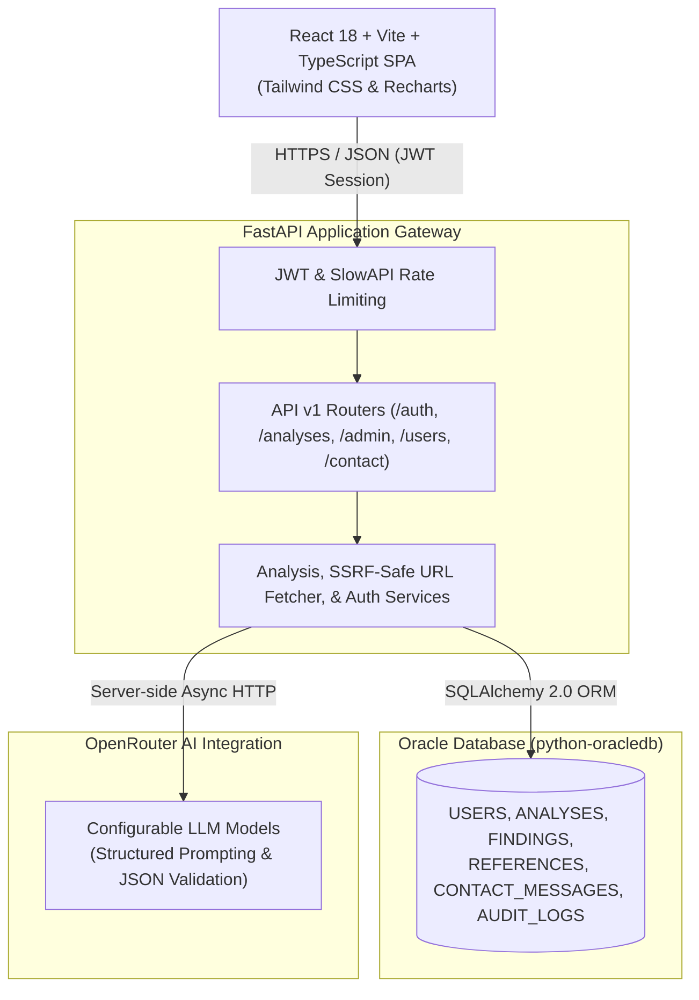

# SOR SENTINEL — AI-Powered Source Credibility and Sensitivity Checker

[](https://fastapi.tiangolo.com)
[](https://react.dev)
[](https://www.oracle.com/database/)
[](https://openrouter.ai)
[]()

SOR SENTINEL is an industrial-style, secure, full-stack decision-support platform designed to critically assess source credibility, surface potentially misleading information indicators, and classify content sensitivity for text and publicly accessible web URLs.

Built specifically for diploma-level industrial project demonstrations, viva examinations, and technical reviews, the application adheres to professional software engineering standards, strong application security practices, transparent limitations disclosures, and strict database normalization.

---

## Architecture Overview



---

## Technology Stack

| Layer | Technologies & Libraries |
|---|---|
| **Frontend** | React 18, TypeScript, Vite 6, Tailwind CSS v3, React Router v6, Recharts, Lucide Icons, Axios, React Hot Toast |
| **Backend API** | Python 3.12+, FastAPI, Pydantic v2, SlowAPI, Structlog, Tenacity, BeautifulSoup4, LXML |
| **Database** | Oracle Database (Free / XE / Enterprise), python-oracledb 2.0+, SQLAlchemy 2.0 ORM |
| **Authentication & Security** | bcrypt (direct lib), JSON Web Tokens (python-jose), SSRF protection, CORS policies, Role-Based Access Control |
| **AI Integration** | OpenRouter API (backend-only proxy with structured prompt contracts) |
| **Testing** | pytest, pytest-asyncio, HTTPX TestClient (39 automated unit & integration tests) |

---

## Directory Structure

```text
SOR_SENTINEL/
├── backend/
│   ├── app/
│   │   ├── api/             # Dependencies and v1 endpoints (auth, users, analyses, admin, etc.)
│   │   ├── core/            # Config (pydantic-settings), security (bcrypt, JWT), structlog logging
│   │   ├── db/              # Oracle SQLAlchemy engine, get_db session dependency
│   │   ├── models/          # SQLAlchemy ORM models (USERS, ANALYSES, AUDIT_LOGS, etc.)
│   │   ├── repositories/    # Data access layer (User, Analysis, Contact, Audit)
│   │   ├── schemas/         # Pydantic validation schemas (requests & responses)
│   │   ├── services/        # Business logic (AI proxy, SSRF-safe URL scraper, analysis engine)
│   │   └── main.py          # FastAPI application entrypoint with lifespan & middlewares
│   ├── tests/               # 39 passing automated unit & integration tests
│   ├── pytest.ini           # Pytest test runner configuration
│   └── requirements.txt     # Python dependencies
├── frontend/
│   ├── src/
│   │   ├── components/      # UI components (Button, Input, Card, Badge, AnalysisResultPanel)
│   │   ├── contexts/        # AuthContext with token session handling
│   │   ├── layouts/         # PublicLayout, DashboardLayout, AdminLayout
│   │   ├── pages/           # Public (Home, Services, About, FAQ, etc.), Auth, Dashboard, Admin
│   │   ├── services/        # Axios API client (typed endpoints)
│   │   ├── styles/          # Design system & Tailwind directives
│   │   └── types/           # TypeScript interfaces & types
│   ├── package.json         # Node.js dependencies & scripts
│   ├── tsconfig.json        # TypeScript configuration
│   ├── tailwind.config.js   # Tailwind CSS v3 configuration
│   └── vite.config.ts       # Vite bundler configuration
├── database/
│   ├── schema.sql           # Complete Oracle DDL with constraints, sequences, and comments
│   ├── init_db.py           # Database initialisation & admin provisioning script
│   ├── verify_connection.py # Oracle connectivity validation utility
│   └── README.md            # Oracle Database setup guide
├── docs/
│   ├── architecture.md      # Detailed system architecture & design patterns
│   ├── api-documentation.md # REST API endpoint reference & schemas
│   ├── testing-report.md    # Automated test execution & verification report
│   └── security-notes.md    # Security controls, SSRF defenses & compliance
├── .env.example             # Environment configuration template
└── README.md                # Project documentation
```

---

## Getting Started & Installation

### 1. Prerequisites
- **Node.js**: v20.x or higher
- **npm**: v10.x or higher
- **Python**: v3.12 or higher
- **Docker** (optional, recommended for local Oracle Database container)

---

### 2. Database Setup (Oracle Database)

Using Docker with Oracle Database Free:
```bash
docker run -d --name oracle-free \
  -p 1521:1521 \
  -e ORACLE_PASSWORD=MySecurePassword123 \
  container-registry.oracle.com/database/free:latest
```

Once running, execute the initialisation script to provision the schema and default administrator:
```bash
python database/init_db.py --admin-email admin@sor-sentinel.local --admin-password "AdminPass123!"
```

---

### 3. Backend Setup

1. Copy `.env.example` to `backend/.env`:
```bash
cp .env.example backend/.env
```

2. Configure your environment variables in `backend/.env`:
```env
ENVIRONMENT=development
SECRET_KEY=generate_a_secure_random_key_for_jwt_signing
OPENROUTER_API_KEY=your_openrouter_api_key_here

ORACLE_USER=sor_sentinel
ORACLE_PASSWORD=MySecurePassword123
ORACLE_HOST=localhost
ORACLE_PORT=1521
ORACLE_SERVICE_NAME=FREEPDB1
```

3. Install Python dependencies:
```bash
pip install -r backend/requirements.txt
```

4. Run the automated test suite:
```bash
cd backend
python -m pytest tests/ -v
```

5. Launch the FastAPI server:
```bash
python -m uvicorn app.main:app --reload --host 127.0.0.1 --port 8010
```
API Documentation will be available at: `http://localhost:8010/docs`

---

### 4. Frontend Setup

1. Navigate to the `frontend` directory:
```bash
cd frontend
```

2. Install dependencies:
```bash
npm install
```

3. Run type verification:
```bash
npm run type-check
```

4. Build production bundle:
```bash
npm run build
```

5. Start local Vite development server:
```bash
npm run dev
```
The application will be accessible at: `http://localhost:5173`

---

## Key Features & Functional Modules

### 1. Public Portal
- **Hero & Mission**: Highlighting AI-assisted critical analysis and decision support.
- **Service Breakdown**: Explanations of text analysis, web page scanning, sensitivity classification, and known limitations.
- **How It Works**: Transparent 7-step request lifecycle from user input to LLM prompt verification.
- **FAQ & Support**: Comprehensive answers, contact enquiry submission, terms, and privacy policy.

### 2. User Dashboard
- **Overview & Statistics**: Personal analysis history, activity volume area charts, and assessment breakdown.
- **Text Analysis**: Direct input (up to 10,000 characters) with real-time length validation and example claim loaders.
- **URL Web Page Analysis**: SSRF-safe content extraction with automatic HTML cleanup via BeautifulSoup.
- **Analysis Result Panel**: Overall score radial gauge, sensitivity indicator badge, categorized findings with confidence levels and source quotes.
- **Analysis History**: Paginated, filterable table with single-item deletion and dedicated detail view.
- **User Profile**: Profile editing and bcrypt-secured password changes.

### 3. Administrator Panel
- **System Telemetry**: Real-time counts for active users, total analyses, pending inquiries, Oracle DB connection status, and OpenRouter reachability.
- **User Management**: Searchable user directory with instant one-click activation/deactivation controls.
- **Analyses Audit**: System-wide view of all submitted analyses, scores, and classifications.
- **Contact Inquiries**: Triage inbox for reviewing and marking inbound messages as resolved.
- **Security Audit Logs**: Immutable chronological audit trail of logins, status mutations, and system actions.

---

## Security Implementation

- **SSRF Defense**: The URL scraper prohibits localhost, private subnets (RFC 1918), link-local IP ranges, cloud metadata addresses (`169.254.169.254`), and non-HTTP protocols (FTP, file, gopher).
- **Password Security**: Passwords are saved exclusively as salted bcrypt hashes with cost factor 12. Plaintext passwords are never stored or logged.
- **Session Tokens**: JWT tokens are signed using HMAC-SHA256 with expiration and issuer checks.
- **Rate Limiting**: SlowAPI limits public and analysis endpoints to prevent brute-force and resource exhaustion.
- **Isolated Credentials**: The OpenRouter API key and Oracle DB password exist strictly in server-side memory and are never sent to the browser.

---

## Academic & Demonstration Disclaimer

SOR SENTINEL is an AI-assisted decision-support platform built for academic and industrial evaluation. All analysis findings are generated by large language models and represent probabilistic interpretations rather than ground truth or definitive legal/medical facts. Users must independently verify critical claims with primary authoritative documentation.
