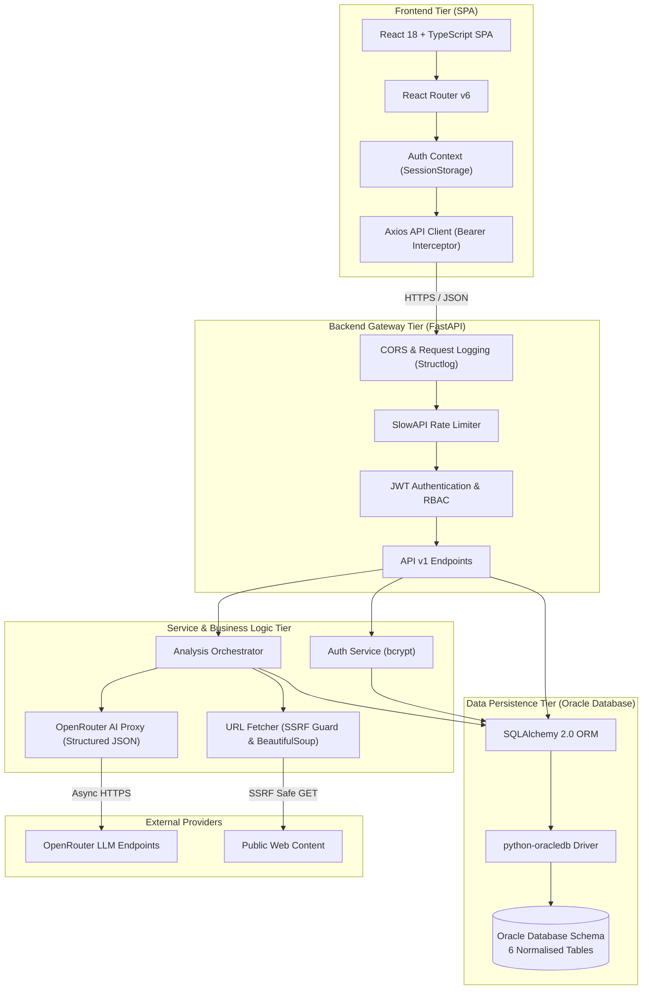
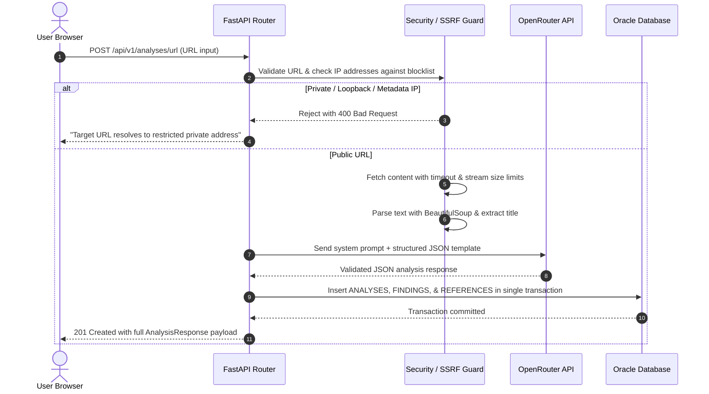

# SOR SENTINEL — Architecture & System Design Document

## 1. Architectural Style & Principles

SOR SENTINEL is built following a decoupled, layered client-server architecture with strict separation of concerns, defensive security boundaries, and relational data integrity.

### Core Architectural Principles
1. **Decoupled Frontend & Backend**: The React SPA communicates with the backend solely via stateless RESTful JSON endpoints over HTTPS.
2. **Backend-Only AI Gateway**: All AI LLM calls are orchestrated exclusively by the FastAPI backend. API keys, prompt injection guardrails, and validation are never delegated to the client.
3. **Defense in Depth**: Every layer performs independent validation (Pydantic in FastAPI, TypeScript contracts on client, DB constraints in Oracle SQL).
4. **Transparent Decision Support**: The system produces structured observations, interpretations, and uncertainty disclosures, never claiming definitive or authoritative truth.

---

## 2. Component Architecture Diagram

---

## 3. Database Schema Design (Oracle SQL)

The persistence layer uses Oracle Database exclusively. The schema contains 6 normalized tables with foreign keys and cascade rules:

1. **`USERS`**:
   - `id` (INTEGER, Primary Key)
   - `full_name` (VARCHAR2 255)
   - `email` (VARCHAR2 255, Unique, Indexed)
   - `hashed_password` (VARCHAR2 255)
   - `role` (VARCHAR2 50, default 'user')
   - `is_active` (NUMBER 1, default 1)
   - `created_at` (TIMESTAMP)
   - `last_login_at` (TIMESTAMP)

2. **`ANALYSES`**:
   - `id` (INTEGER, Primary Key)
   - `user_id` (INTEGER, Foreign Key -> USERS.id, On Delete Cascade)
   - `analysis_type` (VARCHAR2 50, 'text' | 'url')
   - `input_text` (CLOB)
   - `input_url` (VARCHAR2 2000)
   - `status` (VARCHAR2 50, 'pending' | 'processing' | 'completed' | 'failed')
   - `overall_assessment` (VARCHAR2 100)
   - `summary` (CLOB)
   - `credibility_score` (NUMBER 3, 0-100)
   - `sensitivity_level` (VARCHAR2 50, 'low' | 'medium' | 'high' | 'critical')
   - `ai_model_used` (VARCHAR2 200)
   - `processing_time_ms` (NUMBER)
   - `error_message` (VARCHAR2 1000)
   - `created_at`, `updated_at` (TIMESTAMP)

3. **`ANALYSIS_FINDINGS`**:
   - `id` (INTEGER, Primary Key)
   - `analysis_id` (INTEGER, Foreign Key -> ANALYSES.id, On Delete Cascade)
   - `finding_type` (VARCHAR2 100)
   - `category` (VARCHAR2 200)
   - `title` (VARCHAR2 500)
   - `description` (CLOB)
   - `severity` (VARCHAR2 50, 'low' | 'medium' | 'high')
   - `confidence` (VARCHAR2 50)
   - `created_at` (TIMESTAMP)

4. **`SOURCE_REFERENCES`**:
   - `id` (INTEGER, Primary Key)
   - `analysis_id` (INTEGER, Foreign Key -> ANALYSES.id, On Delete Cascade)
   - `title` (VARCHAR2 500)
   - `url` (VARCHAR2 2000)
   - `description` (CLOB)
   - `relevance` (VARCHAR2 100)
   - `created_at` (TIMESTAMP)

5. **`CONTACT_MESSAGES`**:
   - `id` (INTEGER, Primary Key)
   - `name` (VARCHAR2 255)
   - `email` (VARCHAR2 255)
   - `subject` (VARCHAR2 500)
   - `message` (CLOB)
   - `status` (VARCHAR2 50, 'unread' | 'read')
   - `created_at` (TIMESTAMP)

6. **`AUDIT_LOGS`**:
   - `id` (INTEGER, Primary Key)
   - `user_id` (INTEGER, Nullable Foreign Key -> USERS.id, On Delete Set Null)
   - `action` (VARCHAR2 100, Indexed)
   - `resource_type` (VARCHAR2 100)
   - `resource_id` (VARCHAR2 100)
   - `ip_address` (VARCHAR2 50)
   - `created_at` (TIMESTAMP)

---

## 4. Request Lifecycle & Analysis Pipeline

---

## 5. Security & Boundary Rules

1. **Tokens**: JWTs are strictly ephemeral and stored in `sessionStorage` on the client, mitigating cross-tab persistence risks.
2. **Rate Limiting**: Configured using SlowAPI to throttle submission endpoints (e.g., 5 analyses per minute per IP/user) to mitigate denial-of-wallet and denial-of-service risks.
3. **Repository Pattern**: All database access is encapsulated inside repositories (`user_repository`, `analysis_repository`, `contact_repository`). Controllers and services never execute raw queries.
